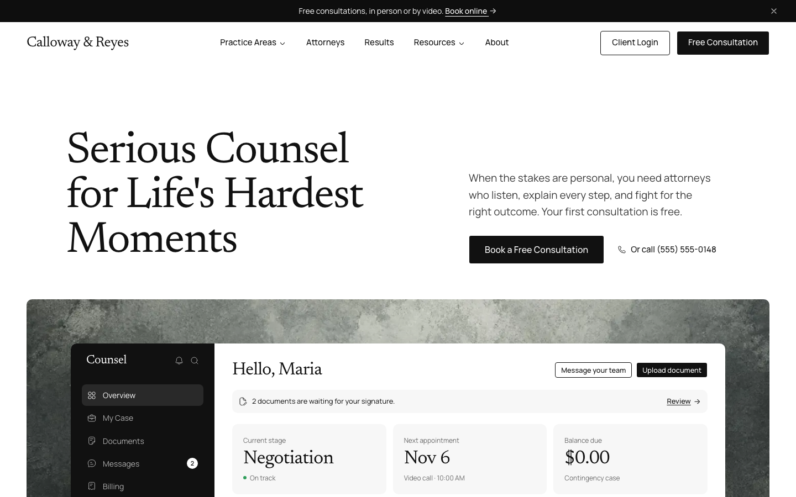
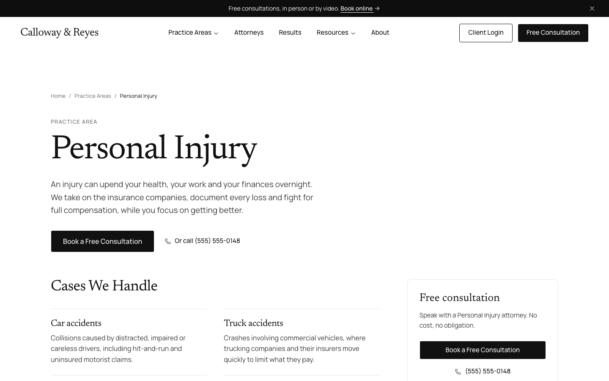
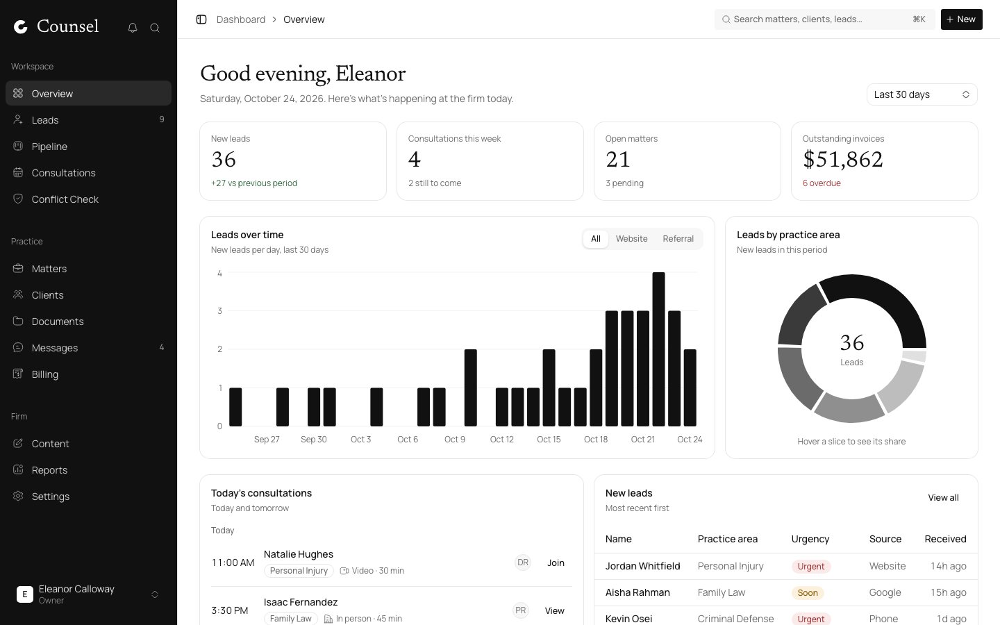
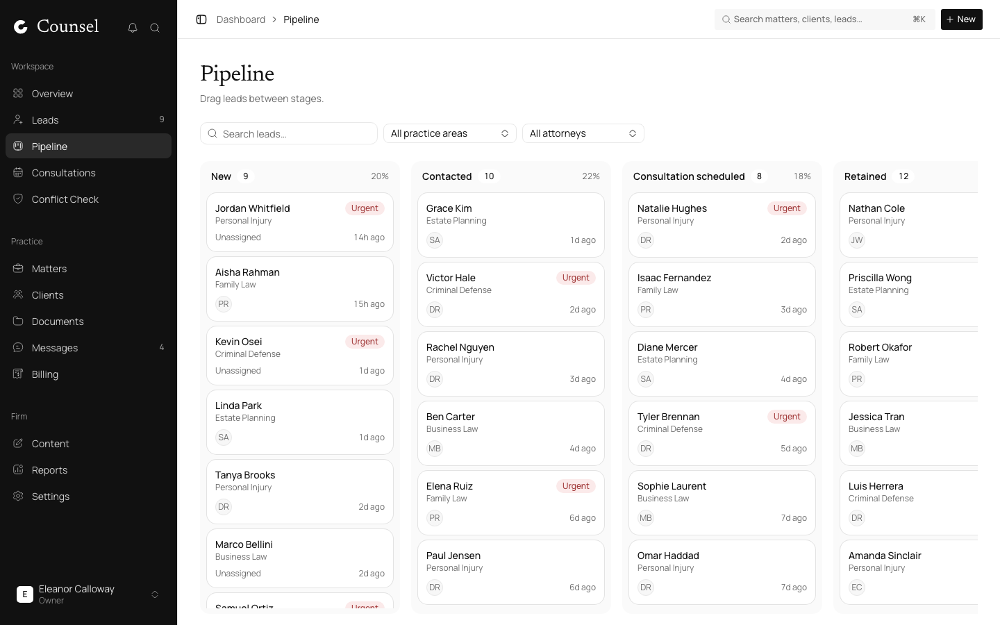
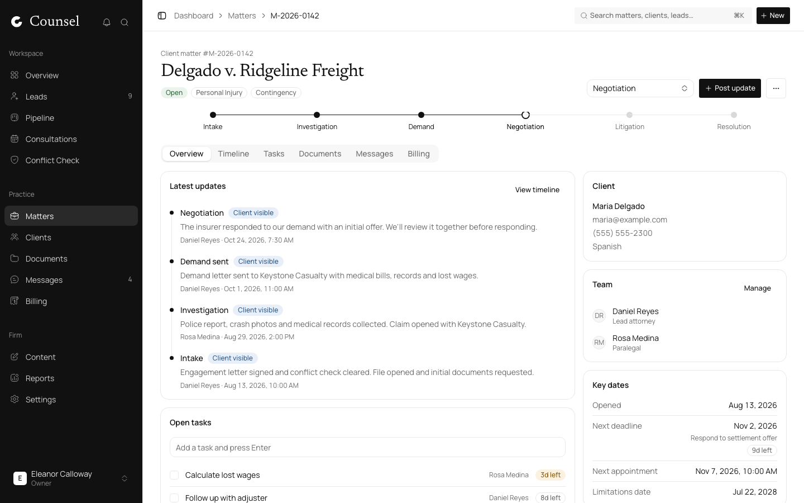
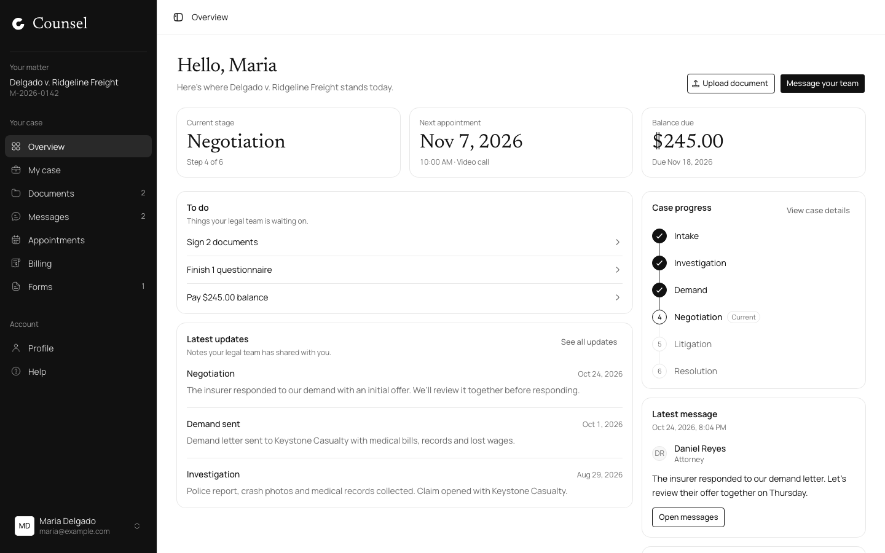
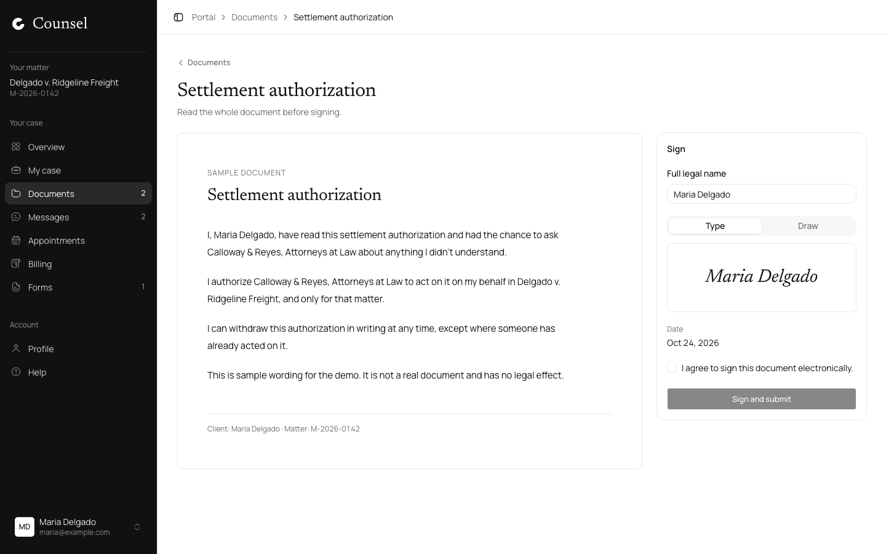

# Counsel

An open-source website, staff dashboard and client portal template for small
law firms, built with Next.js.

[](https://vercel.com/new/clone?repository-url=https%3A%2F%2Fgithub.com%2Fjknithin36%2Fcounsel&env=NEXT_PUBLIC_SITE_URL,NEXT_PUBLIC_DEMO_MODE&envDescription=Public%20site%20URL%20and%20browser-only%20demo%20mode)

**Demo:** https://example.com

Counsel ships as a complete browser-based demo. It builds with no environment
variables and keeps all demo records in the visitor's browser, so it is easy
to evaluate and straightforward to connect to the backend of your choice.

## Screenshots

<table>
  <tr>
    <td width="50%"><strong>Home</strong><br></td>
    <td width="50%"><strong>Practice area</strong><br></td>
  </tr>
  <tr>
    <td><strong>Dashboard overview</strong><br></td>
    <td><strong>Lead pipeline</strong><br></td>
  </tr>
  <tr>
    <td><strong>Matter detail</strong><br></td>
    <td><strong>Client portal</strong><br></td>
  </tr>
  <tr>
    <td><strong>Document signing</strong><br></td>
    <td></td>
  </tr>
</table>

## Features

### Public website

- Responsive firm website, attorney profiles, practice areas, results, legal
  guides, FAQs, contact and consultation flows
- Per-page metadata, canonical URLs, social cards, structured data, sitemap
  and crawler controls
- Keyboard-friendly navigation, semantic landmarks, reduced-motion support
  and reusable content/configuration modules

### Staff dashboard

- Lead intake and pipeline, conflict checks and consultation scheduling
- Client and matter management, tasks, documents, messaging and e-signature
  requests
- Invoicing, payments, trust balances, reports and editable site content
- Role previews, profile preferences, demo export and one-click reset

### Client portal

- Matter timeline, documents, forms, messages and appointments
- Typed e-signature flow and demo invoice payment
- Responsive navigation, profile controls and shared live demo state

## Tech stack

- Next.js 16 App Router, React 19 and TypeScript
- Tailwind CSS 4, Base UI and shadcn-compatible components
- Zustand persisted browser store and Zod validation
- Vitest, React Testing Library, Playwright and axe-core
- Biome formatting/linting and GitHub Actions CI

## Getting started

Requirements: Node.js 22.13 or newer and pnpm 11.

```bash
git clone https://github.com/jknithin36/counsel.git
cd counsel
pnpm install
cp .env.example .env.local
pnpm dev
```

Open http://localhost:3000. The defaults work without `.env.local`; copying it
simply makes the local configuration explicit.

Demo credentials:

| Role | Email | Password |
| --- | --- | --- |
| Staff | `eleanor@example.com` | `demo1234` |
| Client | `maria@example.com` | `demo1234` |

Useful commands:

```bash
pnpm typecheck   # TypeScript
pnpm lint        # Biome lint and format check
pnpm test        # Vitest unit tests
pnpm test:e2e    # Playwright smoke and axe accessibility tests (desktop and mobile)
pnpm build       # production build
pnpm analyze     # build with the bundle analyzer
```

The end-to-end tests build the app and serve it on port 3210, so they don't
clash with a dev server. Install the browser once with
`pnpm exec playwright install chromium`.

## Customize it for your firm

- Firm name, contact details and office information: `lib/config/firm.ts`
- Navigation and product defaults: `lib/config/*`
- Website, dashboard, portal and authentication copy: `lib/content/*`
- Colors, spacing, radii and typography tokens: `app/globals.css`
- Font setup: `app/layout.tsx`
- Textured media panels: replace optimized files in `public/images/textures/`
  and `public/images/hero-texture.webp`

Keep content fictional while developing. Confirm every claim, disclaimer,
testimonial, result and advertising requirement with qualified local counsel
before publishing a real firm site.

## Project structure

```text
app/
  (site)/             public marketing site
  (auth)/             sign-in experience
  dashboard/          staff workspace routes
  portal/             client portal routes
components/
  site/               public-site components
  dashboard/          staff product components
  portal/             client product components
  ui/                 shared UI primitives
lib/
  auth/               demo session boundary
  config/             firm and navigation configuration
  content/            centralized product copy
  data/               data access, selectors, store and demo seed
docs/                 backend integration guide
public/               static images and icons
tests/
  unit/               business-logic tests
  e2e/                browser smoke tests
```

## Bring your own backend

Counsel works with any backend: Postgres, Supabase, Firebase, a REST or
GraphQL API. The UI never talks to storage directly:

- **Reads** come from one client-side store (`lib/data/store.ts`), typed by
  `lib/data/types.ts`.
- **Writes** go through named functions in `lib/data/*` (`createLead`,
  `recordPayment`, `signPortalDocument` and so on). No component writes to the
  store itself.
- **Loading** happens in one place, `ensureDemoData()`, called by the
  dashboard and portal providers.
- **Auth** lives in `lib/auth/session.ts`, with route guards in `proxy.ts`.

To connect a backend, point the loader at your API, make each write function
call it, swap in your auth provider and set `NEXT_PUBLIC_DEMO_MODE=false`.
Pages and components don't change. **[docs/BACKEND.md](docs/BACKEND.md)**
walks through it step by step, with the full list of write functions, code
examples and a suggested data model.

### Going to production

The included demo is not a production legal-practice system. Demo data and
the session are stored unencrypted in `localStorage`; anyone with access to
the browser profile can inspect or change them. A real deployment must add:

- a database such as Postgres with migrations and tenant isolation;
- real authentication, authorization and secure server-side sessions;
- encrypted object storage, malware scanning and retention controls;
- immutable audit logging and appropriate backup/recovery procedures;
- a PCI-compliant payment provider rather than the simulated payment flow;
- transactional email/SMS providers and consent management;
- monitoring, incident response and secrets management; and
- review for attorney advertising, accessibility, privacy, security and data
  protection rules in every applicable jurisdiction.

Suggested replacement map:

| Demo seam | Production responsibility |
| --- | --- |
| `lib/data/demo-data.ts` (`ensureDemoData`) | Load the signed-in user's data from your API |
| `lib/data/store.ts` | Client-side cache only; stop persisting records to `localStorage` |
| `lib/data/*.ts` write functions | Call your API or server actions, then update the cache |
| `lib/data/billing.ts` (`recordPayment`) | A PCI-compliant payment provider with webhooks |
| `lib/data/documents.ts`, `portal.ts` uploads | Encrypted object storage and signed URLs |
| `lib/auth/session.ts`, `proxy.ts` | Your authentication provider and server-side session checks |
| `lib/auth/permissions.ts` | Mirror the same rules on the server; the UI check is not security |

Set `NEXT_PUBLIC_SITE_URL` to the final HTTPS origin in production. Verify the
generated `/sitemap.xml`, `/robots.txt`, social-card URLs and both demo roles on
desktop and mobile before launch.

## Roadmap

- Link the hosted demo in this README
- Add reference adapters for Postgres/Drizzle and common auth providers
  (see [docs/BACKEND.md](docs/BACKEND.md) for the integration points)
- Expand cross-browser end-to-end coverage (Firefox, WebKit)
- Add Lighthouse budgets to CI. Current mobile lab scores: 100 for
  Accessibility, Best Practices and SEO; 86 to 89 for Performance, limited by
  client JavaScript on the public pages
- Split the live-content hooks (`lib/site-content.ts`) so each public page
  ships only the defaults it uses

## Contributing

See [CONTRIBUTING.md](CONTRIBUTING.md). Participation is governed by the
[Code of Conduct](CODE_OF_CONDUCT.md).

## Disclaimer

All names, matters, case results and testimonials in the demo are fictional.
Counsel is a software template, not legal advice, a legal service, a security
certification or a legal-software certification. You are responsible for
professional, regulatory, privacy, security and accessibility review before
using it in practice.

## License

[MIT](LICENSE)
